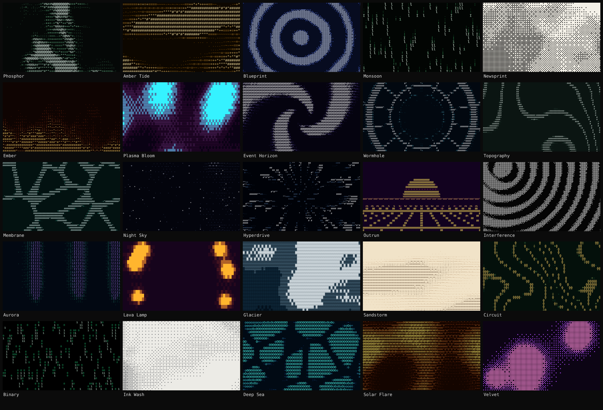
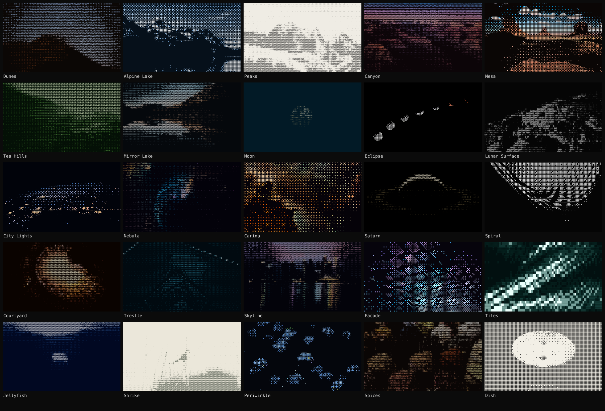

# ascii-dither

Animated ASCII and dither backgrounds, drawn in one WebGL shader and packaged as a [UI SDK](https://github.com/vercel-labs/ui) primitive. The whole look is one `value`, so your app, a person, or an agent can restyle it while it runs.



## Install

```bash
npm install github:albertjunkim/ascii-dither @ui-sdk/core @ui-sdk/react
```

The package ships TypeScript source, so your bundler compiles it. Vite does that as is. In Next.js, add `transpilePackages: ["ascii-dither"]` to `next.config` (that setting hasn't been run against this repo yet).

Or skip the dependency and copy `src/` into your app. It's six files and only needs `@ui-sdk/core` and `@ui-sdk/react`.

## Use a background

```tsx
import { backgrounds } from "ascii-dither"
import { AsciiDither } from "ascii-dither/react"

export function Hero() {
  return (
    <section className="relative isolate min-h-screen">
      <AsciiDither
        className="absolute inset-0 -z-10"
        defaultValue={backgrounds.aurora}
      />
      <h1>Your content</h1>
    </section>
  )
}
```

Size it with a class or `style`; the canvas fills the root. Each background sets its own ink and backdrop colours.

The 25 names: `phosphor`, `amberTide`, `blueprint`, `monsoon`, `newsprint`, `ember`, `plasmaBloom`, `eventHorizon`, `wormhole`, `topography`, `membrane`, `nightSky`, `hyperdrive`, `outrun`, `interference`, `aurora`, `lavaLamp`, `glacier`, `sandstorm`, `circuit`, `binary`, `inkWash`, `deepSea`, `solarFlare`, `velvet`. `backgroundNames` lists them and `backgroundLabel("amberTide")` gives `"Amber Tide"`.

To browse them live:

```bash
npm install
npm run gallery
```

## Use a photo background



Another 25 looks are built on photos in `images/`. Serve that folder from your app first:

```bash
cp -r node_modules/ascii-dither/images public/ascii-dither
```

```tsx
import { imageBackground } from "ascii-dither"
import { AsciiDither } from "ascii-dither/react"

<AsciiDither className="absolute inset-0 -z-10" {...imageBackground("dunes")} />
```

`imageBackground(name, base)` returns the photo's URL and its tuned style; `base` defaults to `/ascii-dither`.

The 25 names: `dunes`, `alpineLake`, `peaks`, `canyon`, `mesa`, `teaHills`, `mirrorLake`, `moon`, `eclipse`, `lunarSurface`, `cityLights`, `nebula`, `carina`, `saturn`, `spiral`, `courtyard`, `trestle`, `skyline`, `facade`, `tiles`, `jellyfish`, `shrike`, `periwinkle`, `spices`, `dish`.

The photos come from two public wallpaper collections that describe them as CC0 or public domain. [`images/CREDITS.md`](images/CREDITS.md) lists every source; check it before you ship them.

## Make your own

A background is a partial style. Anything you leave out keeps its default, and you can start from a built-in one:

```tsx
<AsciiDither
  defaultValue={{
    ...backgrounds.eventHorizon,
    color: "#ff5c8a",
    chars: " .:xX#",
    speed: 0.4,
  }}
/>
```

| Key | Takes | Default |
| --- | --- | --- |
| `pattern` | `flow` `waves` `ripple` `rain` `plasma` `vortex` `tunnel` `contours` `cells` `stars` `warp` `grid` `moire` `aurora` `fire` `blobs` | `flow` |
| `mode` | `ascii` (glyphs) or `dots` (square Bayer dots) | `ascii` |
| `chars` | Glyph ramp from emptiest to densest, 2 to 32 characters | `" .:-=+*#%@"` |
| `color` | Ink colour: hex, `rgb()`, `hsl()` or a named colour | `#7cffb2` |
| `accent` | Second ink colour the densest glyphs blend toward, or `null` | `null` |
| `background` | Colour behind the ink | `#050807` |
| `cellSize` | Glyph height in px, 6 to 32 | `12` |
| `speed` | 0 to 3 | `1` |
| `contrast` | 0 to 10. Higher leaves more empty space | `5` |
| `brightness` | -1 to 1. Lifts or lowers the whole field, like exposure | `0` |
| `scale` | 0.3 to 4. Size of the shapes | `1` |
| `dither` | 0 to 1. How much the Bayer pattern breaks up tone bands | `1` |
| `vignette` | 0 to 1. Thins the field toward the edges | `0` |
| `fps` | 6 to 60. Low values look stepped and retro | `24` |
| `invert` | Flips brightness, like dark ink on a light page | `false` |
| `colorMode` | With an image: `source` tints each cell from the picture | `mono` |
| `flow` | With an image: how much the motion stirs it, 0 to 1 | `0.25` |

Control it like any UI SDK component: `defaultValue` to start, or `value` with `onValueChange(value, details)`. The same goes for `paused` and `image`.

## Filter an image or video

```tsx
<AsciiDither image="/hero.jpg" defaultValue={{ colorMode: "source" }} />
```

`image` takes any URL from your app, image or video. A file from another origin needs CORS headers; without them `data-image="error"` is set on the root and the pattern shows instead.

## Let an agent restyle it

The primitive declares what an agent may do, so UI SDK's bridge can drive it with no extra tool definitions:

```ts
import { createAgent } from "@ui-sdk/react/agent"

const agent = createAgent()

await agent.act({
  steps: [
    {
      ref: "Background",
      action: "setValue",
      args: [{ pattern: "rain", color: "#6cff8e", background: "#000" }],
    },
  ],
})
```

| Action | What it does |
| --- | --- |
| `setValue(style)` | Replaces the look, with defaults for any key left out |
| `tweak(patch)` | Changes only the keys given |
| `applyPreset(name)` | Applies a built-in background, like `"Aurora"` or `"Dunes"` |
| `setImage(name)` | Shows one of the pictures you list in `images` |
| `clearImage()` | Goes back to the pattern |
| `setPaused(boolean)` | Freezes or resumes the motion |

- A value that doesn't fit is refused with a message that says what the key takes, so a model can correct itself.
- `onValueChange` gets `details.source === "agent"`, and `details.cancel()` refuses the change.
- An agent can only load pictures you offer: `images={{ Dunes: "/dunes.jpg" }}`. To allow other addresses, pass `allowImage={(url) => url.startsWith("/uploads/")}`.
- `images={imageSources()}` offers all 25 photos, which also makes the photo backgrounds available to `applyPreset`.
- `asciiDitherGuide` is a short description of the style keys and actions for your model's instructions.

UI SDK doesn't run the model for you. Hand `agentTools` from `@ui-sdk/react/agent` to your model SDK and route each call to `agent.snapshot`, `agent.act` or `agent.query`, or call `registerTools(agent, { allow })` for a browser agent.

## Other frameworks

`asciiDither` is a framework-free primitive. `src/react.tsx` is the whole React layer: one `createParts` call and a wrapper. Vue, Svelte, Solid and web components need the same few lines with their own adapter; only React is written and tested here.

For no framework at all, mount the renderer on a canvas:

```ts
import { backgrounds, mountAsciiDither } from "ascii-dither"

const renderer = mountAsciiDither(canvas, () => backgrounds.outrun)
```

The ink is the canvas's CSS `color`, so set `color` and `background` on it yourself.

## Good to know

- Each instance holds one WebGL context, and browsers cap those at around 16 per page. Keep to a few live backgrounds per page.
- It pauses while off screen and holds a still frame when the person prefers reduced motion.
- Checked in headless Chrome. It hasn't been run on Safari or on phones yet.
- UI SDK is in beta (`0.1.0-beta.10` here), so its API may change.

## Develop

```bash
npm run typecheck
npm test
npm run gallery
```
